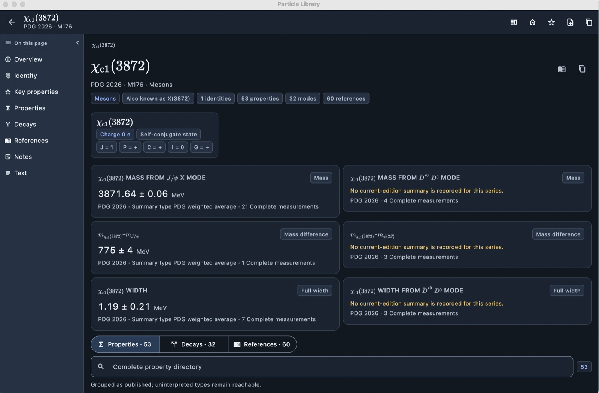
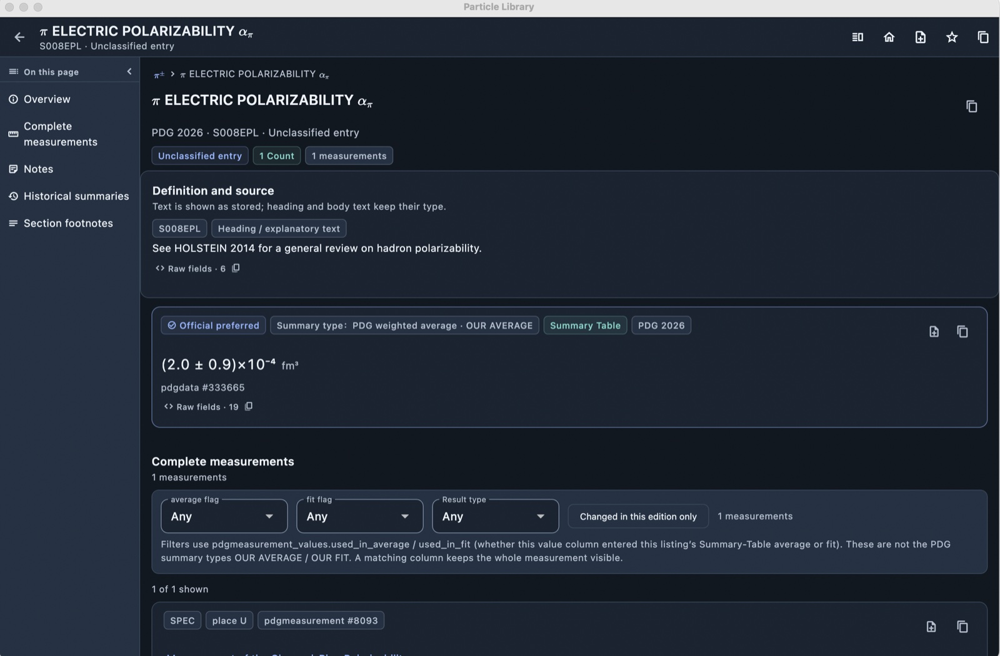
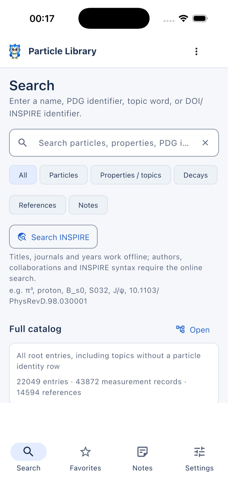

<p align="center">
  
</p>

# Particle Library

[English](README.md) | **简体中文**

Particle Library 是一个离线 PDG（Particle Data Group）粒子数据浏览器，面向高能物理及相关领域的科研使用。PDG 数据快照保持只读且保存在本机，笔记、收藏、标签和 PDF 批注与数据分开存储。

在周末使用 **DeepSeek Harness** 与 **DeepSeek-V4.1-Flash-1017** 构建。

**支持平台：** macOS 12+（通用二进制）、iPhone/iPadOS 15+，以及 Android 7.0+（API 24，预览 APK）。各平台共享 Flutter 响应式布局。

## 截图

| X(3872) | π 电极化率 |
| --- | --- |
|  |  |
| 粒子页：左侧页面目录、身份、量子数与右侧上下文栏。 | 测量页：左侧目录、定义与来源、PDG 平均和右侧上下文栏。 |

| iPhone |
| --- |
|  |
| iPhone 响应式布局。 |

英文界面、PDG 2026 数据快照；桌面为深色主题，iPhone 为浅色主题。

## 功能

- **离线 PDG 数据**：只读 SQLite 快照，SHA-256 完整性校验、首次启动安装、schema 校验和原始字段查看。
- **搜索与导航**：粒子名与别名、希腊字母/LaTeX 写法、MC 编号、PDG 标识符、专题、衰变、文献和全文搜索。
- **条目页面**：粒子、专题、衰变模式、系列/性质和文献页面，包含汇总、全部测量、误差、脚注、历史、文献和原始记录。
- **数据语义**：区分 PDG Average / PDG Fit；保留 limit、range、CL、scale factor 和 used-in-average/fit 等字段，不擅自归一化。
- **数学排版**：PDG ASCII 表达式、粒子符号、衰变方程和单位在无歧义时排版为数学；否则保留原文。
- **历史与趋势**：按版次查看汇总值和带非对称误差的趋势图。
- **笔记**：本机 Markdown 笔记，支持锚点、反向链接、Collection、标签、搜索、导入/导出和冲突保护；所有“加入笔记”入口共用同一个选择器。
- **标签**：跨笔记筛选、浏览、重命名和删除。
- **文献**：本地文献信息、可选 Crossref 题名补全、INSPIRE 搜索、BibTeX/cite key 和 Zotero 本地桥接。
- **Zotero 索引（仅 macOS 桌面）**：手动构建/更新的本地 Zotero 条目缓存，避免 INSPIRE 结果逐条请求。
- **PDG 综述**：按需缓存 PDF、选择性清理、PDF 文字高亮；高亮直接存为带 review anchor 的本地笔记，可搜索、打标签、导出，并显示在右侧批注栏。
- **桌面工作区**：可独立收起的左侧页面目录和右侧上下文栏、可拖拽分栏、移动端紧凑布局。
- **双语界面**：中文/英文界面，支持跟随系统、浅色/深色主题。
- **更新检查**：后台检查新版本，Settings → About 也可手动“检查更新”，提示后打开下载页面。

## 环境要求

- macOS 12 或更高版本（通用二进制；已在 macOS 15.6 Apple Silicon 验证）；
- iOS/iPadOS 15 或更高版本；
- Android 7.0+（API 24）预览版 APK。

正式发布包会内置 PDG 快照。只有从源码构建才额外需要 Flutter/Xcode 和快照文件；这些是**贡献者**要求，见 [BUILDING.md](docs/development/BUILDING.md)。

源码构建可从 PDG 官方下载本版本使用的快照：

- [pdgall-2026.0.sqlite](https://pdg.lbl.gov/2026/api/pdgall-2026.0.sqlite)
- [PDG API 下载页](https://pdg.lbl.gov/2026/api/index.html)

## 安装

首个公开预览版是 **[Release 0.1.0](https://github.com/fkguo/Particle-Library/releases/tag/v0.1.0)**。

- **macOS 12+（通用二进制）**：下载 Release 中的
  `Particle-Library-macOS-0.1.0.zip`。当前为 ad-hoc 签名、未公证；首次打开请
  **右键 → 打开**，或在 **系统设置 → 隐私与安全性** 中允许。运行前请核对
  `SHA256SUMS.txt`。
- **iPhone/iPad**：暂时没有公开 IPA 或 TestFlight 安装包。源码构建和开发签名安装
  已验证；公开分发需要付费 Apple Developer Team。
- **Android 7.0+（API 24）**：Release 中提供已签名预览 APK；现代手机用
  `arm64-v8a`，旧 32 位设备用 `armeabi-v7a`，模拟器用 `x86_64`。详见
  [Android 构建说明](docs/development/ANDROID.md)。
- **Windows/Linux/web**：0.1.0 未构建。

macOS 版已内置 PDG 快照，普通用户不需要 Flutter、Xcode 或源码。源码构建者可直接下载
[`pdgall-2026.0.sqlite`](https://pdg.lbl.gov/2026/api/pdgall-2026.0.sqlite)（
[PDG 官方 API 页面](https://pdg.lbl.gov/2026/api/index.html)），该文件不再作为 Release asset。

应用 Bundle ID 为 `io.github.fkguo.particlelibrary`。详见
[RELEASING.md](docs/development/RELEASING.md)。

## 从源码构建

- [构建说明（英文）](docs/development/BUILDING.md)
- [平台支持矩阵（英文）](docs/development/PLATFORMS.md)

macOS 已验证的简短流程：

```bash
# 先下载官方快照；详见 assets/README.md：
# curl -LO https://pdg.lbl.gov/2026/api/pdgall-2026.0.sqlite
# mv pdgall-2026.0.sqlite assets/
flutter pub get
flutter test
flutter build macos --release
open "build/macos/Build/Products/Release/Particle Library.app"
```

## 测试

```bash
flutter analyze
flutter test
```

测试覆盖快照契约、显示语义、数学解析、笔记/标签、PDF 批注坐标与持久化、Zotero 缓存解析和 UI 辅助逻辑。除显式联网测试外，测试不需要网络。

## 本机数据与隐私

- PDG 快照只读并校验哈希；
- 笔记和用户设置保存在独立 SQLite 数据库；
- 收藏、最近搜索和 Zotero 索引保存在应用支持目录；
- PDG 综述 PDF 按需下载，不包含在仓库中；
- Zotero 仅通过 `http://127.0.0.1:23119` 只读访问，且仅桌面版可用；
- 更新检查会在启动时和手动点击时访问 GitHub Releases API，这会将 IP 地址披露给 GitHub；不发送遥测或使用数据，也不会静默安装更新。

## 仓库结构

```text
lib/            Flutter 应用
test/           单元与 widget 测试
assets/         图标/主题资源；PDG 快照需自行提供
macos/          macOS runner
ios/            iOS runner
docs/           设计与开发文档
```

## 文档

- [文档索引](docs/README.md)
- [产品设计](docs/design/PDG_App_Design.md)
- [数据图集](docs/design/PDGall_Data_Atlas.md)
- [数学转换规则](docs/design/Math_Conversion.md)
- [衰变结构设计](docs/design/Decay_Structure_Design.md)
- [开发路线与跨平台计划](docs/development/ROADMAP.md)
- [许可说明](docs/development/LICENSING.md)
- [更新检查](docs/development/UPDATES.md)

开发文档目前以中文为主；构建/平台说明为英文。

## License

- **应用代码**：Mozilla Public License 2.0（MPL-2.0），见 [LICENSE](LICENSE)。Copyright 2026 Particle Library contributors。
  源码：<https://github.com/fkguo/Particle-Library>。
- **PDG 数据快照**：CC BY 4.0，需保留 Particle Data Group 署名；MPL-2.0 不覆盖数据。
- **PDG 综述 PDF**：不随仓库分发；从 PDG 下载并受 PDG 条款约束。
- **第三方依赖**：见 [THIRD_PARTY_NOTICES.md](THIRD_PARTY_NOTICES.md)。

本项目是独立应用，不是 PDG 官方产品。
