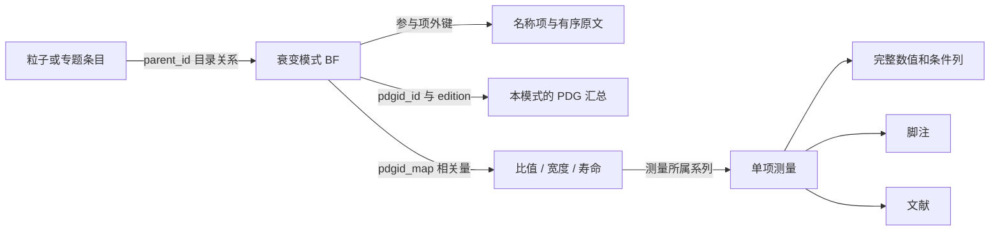

# 衰变结构、查询与测量关联详细设计

版本：1.0　日期：2026-10-13

衰变是应用的核心对象。用户既能从母粒子查看衰变模式，也能从指定产物寻找产生它的衰变，并沿衰变模式读到分支分数、相关比值、单项测量和实验限定。手机以可展开的结构列表为主，桌面增加树与详情并排显示；图形与文字表达同一组已核查的数据。

配套规范：[总体设计](PDG_App_Design.md)、[数据库全字段说明](PDGall_Data_Atlas.md)。以下规则以 `pdgall-2026.0.sqlite` 的实际结构为基线；源库更新时重新检查，不能仅沿用数量或假定新条目遵循旧特例。

## 1. 数据能表达什么

| 实际内容 | 本快照规模或情况 | 产品要求 |
|---|---|---|
| BF 模式 | 7,938 个，各有 `pdgdecay` 行 | 全部模式均有原文入口，包括仅有文本/定性结果者 |
| 参与项记录 | 30,357 行；7,938 行 incoming、22,419 行 outgoing | 同时保存母项、顺序、名称项类型和倍数 |
| 重复参与项 | 652 行 `multiplier>1`；最大倍数 6 | 显示重复数；不能把集合去重后的数量当粒子多重数 |
| 缩进模式 | 1,959 个；BFX 最大缩进 5，BFI 最大缩进 2 | 保留全部层级与祖先语境 |
| 明确子衰变外键 | `subdecay_id` 全部为空 | 当前库不能仅靠该字段得到级联图 |
| 文本项 | 3,804 个模式的 outgoing 中含 T 型项 | 文本可能是粒子别称、箭头、标点、条件或分组，不可一律做粒子节点 |
| 不完整参与项 | 19 个模式只有 incoming 行 | 显示原始描述，标明结构未完整提供；不画空末态 |
| 直接单项测量 | 所有 BF* 条目直接测量均为零 | 不能显示成“PDG 没有相关实验” |
| 相关量映射 | 7,580 个 BF 有映射；7,561 个可一跳到有测量的条目 | 显示相关量及路径，保留原量定义 |
| 映射端点类型 | 12,317 条到 BR、5 条到 G、12 条到 T | 相关量不全是比值，也可能是宽度/寿命 |

这些数量不意味着 7,938 个末态已全部解析。完整来源浏览与语义结构查询是两个分别验收的能力。

## 2. 四种关系必须分别建模

### 2.1 条目树：PDG 如何排列衰变模式

`pdgid.parent_id` 给出官方条目父子关系，`data_type` 的 BFX/BFI 后缀给出显示缩进层级，`sort` 给出原序。用于目录树、展开/收起、祖先说明、相邻模式浏览。

条目树包含包含关系、模式细分、排除某共振的子样本、振幅分量和其他章节约定。缩进子项不自动是“母项中的某个粒子随后衰变”。例如 `S035.27` 在 `S035.218` 之下，是带排除条件的模式；其子项 `S035.201`、`S035.282`、`S035.283` 带不同末态或 scalar/vector 限定，不能直接相加。

子节点按实际 `parent_id` 查询。不能仿照只查同一个 BF 前缀且缩进加一的便利算法：本库有 BFI 父接 BFX 子、BFX 父接 BFI 子、缩进跳级，以及直接位于 PART 下的 BFX1。缩进数字用于保真显示，父键用于实际连接；不为了形成整齐树而改写原关联。

### 2.2 参与项序列：本条目写了哪些对象

`pdgdecay` 给出有序参与项。每行保存 `pdgitem_id`、原始 `name`、incoming/outgoing、`multiplier`、`sort` 和可能的 `subdecay_id`。

一行 outgoing 不一定是一个最终产物。T 型项中实际存在 `-->`、逗号、括号、加号、分组碎片以及没有结构映射的共振名称。含多个箭头的描述可能同时列中间态和后续末态；直接收集所有 outgoing 会把不同阶段混在一起。

原始 `pdgid.description` 始终是完整描述的显示依据。参与项用于可点击标注和结构解释，但重构文本若与描述不一致，保留描述及原始参与项，不覆盖源文。

### 2.3 明确的衰变阶段：谁衰变成谁

分为三种来源，界面必须能辨别：

1. **数据库显式关联**：非空 `subdecay_id` 指定的后续模式。当前快照没有这种边；以后存在时仍需核对端点及版次。
2. **原文解析关系**：原始描述与参与项中存在箭头/括号，经过有边界的语法解释和例项核对才生成阶段。保留原文片段、参与项行和解析规则版本。阶段箭头有时表达整组中间态到另一组末态，不能擅自给每个中间粒子分配子节点。
3. **用户继续浏览**：用户点某产物打开该粒子的其他 PDG 衰变。这个浏览动作不是源条目所指定的级联，单独显示“继续查看该粒子的衰变”，不与本条目的实线结构混合。

首版不自动展开到全部“稳定粒子”，不根据粒子名称猜中间态寿命，不计算级联总分支分数。明确的阶段关系可以展示，但不提供蒙特卡洛事件发生器式完整衰变树承诺。

### 2.4 相关量网络：如何找到实验与比值

`pdgid_map.source_id → target_id` 在当前库把 BF 条目连接到相关的 BR、G 或 T。应用显示“相关测量量”，并按目标条目的真实定义显示名称与类型。

`type=D` 或 `sort=1` 不提供分子/分母角色，不提供比例、求和、拟合权重或协方差。一个 BF 可以连到把它放在分母的比值，也可连到总宽度；一个比值也可以关联多个模式。只凭关系边不能把比值值复制成该 BF 的分支分数。



此图表达数据库关系；不是物理级联图或某次拟合的依赖图。

### 2.5 外键为空时，如何使用已经保存的结构

`subdecay_id` 不是衰变结构的唯一载体。当前快照的目录关系存在于 `parent_id`；阶段边界可以存在于有序名称项中的箭头，也可能包含在一个 T 型文本片段或完整 description 中。外键没有填充，不能直接推出这些信息没有收录或不能使用。

对 7,938 个模式，按 incoming/outgoing、sort、multiplier 和 name 重组描述，7,804 个与 description 逐字相同；仅忽略空白字符时有 7,838 个相同，余下 100 个需要对照完整 description。这个检查说明多数原始描述可从参与项重建，不证明其物理语法或粒子身份已经全部解释。

1,199 个模式的 description 含两个或更多箭头符号，其中 900 个模式在参与项表中有独立箭头项，共 954 行。箭头计数是语法观测，不单独证明阶段解释正确。不能只处理独立箭头而遗漏嵌在复合文本中的边界。首版数据适配应同时读取参与项和完整描述，覆盖整条源表达，再解释分组、条件及阶段。

以 `S035.286` 为例，按 sort 可恢复两个产物组：第一组为 K⁻、ρ⁰、ντ，第二组为 K⁻、π⁺、π⁻、ντ。两次出现的 K⁻ 和 ντ 属于不同阶段的描述，不能当成一次衰变生成了两个 K⁻ 和两个 ντ。继续将组级变化解释成具体 ρ⁰ 的子衰变，需要确认跨阶段对象对应、身份与限定；两组本身已可保真展示。

对没有 outgoing 行的条目，description 仍可能完整，如 `S035.319`。必须将描述解析作为实际恢复路径，不能把“参与项缺失”固定成永远无法结构查询。需逐类建立受支持语法和例外映射，对所有残留片段列明原因与处理清单；只对仍存在实质多义性的部分保留待判。

官方 schema 明确说明：按 sort 拼接 pdgdecay 各项可得到对应条目的衰变描述；subdecay_id 用于指定某个产物的特定后续衰变。官方 `subdecays()` 文档另行说明，缩进子项按 Particle Listings 原样返回，解释取决于所在章节约定；公开实现从条目父子关系查询这些子项。这支持分别利用有序原文和目录树。已查的公开资料没有解释本版为何未填该列，产品不将生产端原因的猜测写成事实。[schema](https://pdgapi.lbl.gov/doc/schema.html)、[衰变 API 文档](https://pdgapi.lbl.gov/doc/pdg.decay.html)、[固定版本参考实现](https://github.com/particledatagroup/api/blob/bad368a8e628827ebe29b50d028328f24a563576/pdg/decay.py)

官方发布的标准库 `pdg-2026.0.sqlite` 同样没有非空 subdecay_id；其 pdgid、pdgdecay、pdgitem、pdgitem_map、pdgid_map、pdgtext 六张表与本设计使用的 pdgall 对应表逐行相同。因此不能将该情况归因于本地 pdgall 文件损坏，或认为去掉历史数据换成标准库就能得到已填好的级联外键。[官方数据文件入口](https://pdg.lbl.gov/2026/api/index.html)

## 3. 首版必须具备的衰变功能

| 功能 | 用户行为 | 默认结果 | 范围 |
|---|---|---|---|
| 全模式目录 | 打开粒子→衰变 | 官方次序、缩进、全体模式及数量 | 包括没有数值汇总的模式 |
| 树与平铺切换 | 展开层级或显示全部 | 平铺仍显示祖先路径 | 搜索命中子项时保留祖先语境 |
| 模式文字检索 | 在描述/条件中找名称或词 | 原文命中，标“文字匹配” | 不冒充末态物理匹配 |
| 产物反查 | 从某粒子/名称项选择“查找相关衰变” | 分开显示直接名称项关系与已核查末态匹配 | 不自动加入反粒子 |
| 结构化末态条件 | 选择产物、数量、包含/恰好 | 确定命中、待判分区及覆盖数 | 仅已核查语法能给确定结论 |
| 模式详情 | 点某模式 | 原文、参与项、缩进父子、本模式汇总、相关量 | 原文永远可复制 |
| 相关测量 | 点相关量 | 保留真实定义的全部测量及列 | 不把比值行重命名为 BF 测量 |
| 限定和脚注 | 展开条件 | 本模式说明、关联量说明、每条测量脚注各自归属 | 不把某条脚注广播成模式全体条件 |
| 历史汇总 | 进入本模式的版次表 | 实际可用版次及完整显示值 | 结构仍属于当前快照 |
| 收藏与复制 | 收藏模式或查询 | 保存模式标识、快照、筛选与条件 | 不以 mode_number 作为持久身份 |

结构化反查是首版核心交付，首版必须有实际核查通过的常见二体、多体和重复产物模式；复杂文本仍可查询原文并列待判。不得用“先显示描述、以后再做结构”替代整个衰变功能。也不得为赶工将全部复杂模式自动判为不匹配。

跨模式分支分数数值筛选可作为后续增强：需要先核对归一化、包容/排他定义、产品分支分数和上限语义。首版可按结果类型、是否有汇总、是否有相关测量筛选；“最大分支分数”排序只在明确同母态、同归一化、可比较的完整点值集合内提供。

## 4. 名称项、集合与多重数

### 4.1 每个参与项的解析状态

| 状态 | 例子或触发 | 允许动作 |
|---|---|---|
| 具体身份唯一 | 一个名称项对应一个已核查粒子记录 | 跳转粒子、用于明确结构条件 |
| 明确集合 | 通用名称或多电荷名称映射到多项 | 展开候选；集合不能显示成同时出现的多个粒子 |
| 别名唯一 | A/W/S 经映射到唯一身份 | 跳转并说明使用的原始名称 |
| 身份冲突 | 同一名称项连接多个不等价 listing | 显示候选和定义；用户选择不改官方数据 |
| 包容项 | I 型 X/anything | 显示未列出的产物；不枚举未知粒子 |
| 文本条件 | 排除项、nonresonant、波、helicity 等 | 显示条件并保留作用范围 |
| 语法记号 | 箭头、括号、分隔符 | 仅用于有据解析，不作为粒子 |
| 未解析文本 | T 型名称或未支持语法 | 原文可读/可搜索，结构结果待判 |

不能简单按 `item_type=P` 认定唯一：当前有 `pdgitem_id=1593` 同时连到 `B185` 与 `B205`，名称和电荷相同而 listing/量子数不同。也有 P→P 的中微子映射，不能通过走映射就悄悄抹去原始粒子/反粒子写法。

查名称项时先保留直接粒子行，再保留映射候选及路径；别名、通用集合和跨身份映射分别解释。出现多义时不开唯一粒子页。中文/LaTeX 规范化只负责找候选，不改变物理身份。

### 4.2 重复数

原始数据同时允许一个参与项的 `multiplier=2`，以及两行各 `multiplier=1`。原始显示保留各行；只有在同一已确认阶段、同一确定身份、同一适用条件内才可将数量聚合。

例如 `S009.1` 的两个光子来自 `multiplier`，而 `S032.1` 是两个不同产物。索引必须能区分“至少一个光子”“至少两个光子”“恰好两个光子且无其他末态”。将参与项转换成去重 set 会丢失这些区别。

### 4.3 电荷与共轭

默认保持实际记录的电荷和反粒子写法。用户可显式选择“同时查询共轭模式”，但需要已核查的共轭身份表，分别显示两组结果及是否由源库直接列出；不制造源库没有的共轭分支分数。

`pi+-` 与 `W-+` 之类表达可能具有成对约束。不能对两个集合做独立笛卡尔积，从而生成原文没有的同号组合。未能从原文确定耦合约束时保留为整体复合项并列待判。电荷守恒可用于发现解释错误，但不能代替原文决定组合。

### 4.4 选择、求和与条件

括号、斜线、`+`、逗号和连字符都不能全局按一种语法解释。正号可能是电荷或模式求和，斜线可能是候选也可能属于比值，逗号可能分隔态集合或附加条件。语法规则按片段类型、系列和上下文确定，所有原文字符必须被解释或明确留作未解析部分。

不以“能提取到几个已知粒子名”为整个表达式解析成功的判据。删除未知词后形成的干净结构不能用于精确末态查询。

## 5. 结构化查询语义

### 5.1 表单

查询页的“衰变”范围提供：母粒子/所属专题（可不选）、一个或多个产物、每个产物的最小数量、匹配模式、阶段范围和附加筛选。默认只查询原文明确给出的直接衰变阶段；对于有多阶段描述但阶段归属未明的模式，列待判。

阶段范围分为：

- “直接产物”：只使用已确认属于首个衰变阶段的产物。
- “原文所列后续末态”：只使用条目明确展示并已核查的最后阶段；不递归推导未写出的衰变。
- “任何位置提到”：名称项/文字检索，明确标为提及，不等于末态成员。

包含/恰好、粒子电荷、是否含共轭、是否显示待判、章节范围、结果类型都进入已执行查询摘要。输入草稿与上一次结果分开；改变阶段范围必须重新提交。

### 5.2 “包含这些产物”

在已经确定的同一阶段内，对具体身份组成的多重集合比较最小数量。若明确有足够的指定产物，允许其他产物存在。包容项 X 不否定已明确列出的成员，但 X 不能证明缺少的指定粒子一定存在。

若多个候选构成一选一集合：所有允许解释都满足时可判真；所有允许解释都不满足且表达完整时判假；存在满足与不满足两种解释时为未知。不同别名到同一身份的路径去重，但不同物理候选不压成一个。

### 5.3 “恰好这些产物”

只对已确认完整、排他的同一阶段多重集合判定相等；无其他粒子、无包容项、无未解析片段、无未处理共轭约束，且所有要求数量相同。仅有 BFX 类型不够：BFX 描述也可能包含级联、分组和限定。

对于 X、anything、invisible、hadrons、宽泛集合、参与项缺失、未知片段或未解析箭头，不能凭当前可见粒子清单判“恰好”。保留为未知并写出原因。

### 5.4 文本中的排除和动力学条件

`ex.K0`、nonresonant、scalar/vector、S-wave、helicity 等保留为有作用域的限定。默认不把这些词中的粒子算成产物。若用户要求排除某中间态，应有单独“已明确排除”条件；词语搜索结果仅表示提及。

首版未全面支持的限定语法不能从精确结果中删掉。某模式的产物成员已明确，但动力学条件与用户查询未冲突时，可以显示成员命中并附限定；如果用户要求整个模式等价或排除条件匹配，则须单独核验这些限定。

### 5.5 完整性与计数

先确定候选范围，例如某母粒子/专题所有 BF 条目。为每个候选保留“真、假、未知”及原因，三类数量之和必须等于该范围模式数。索引可以加速确定候选，但不得把未解析模式从候选全集静默删除。

未解析模式即使没有提取到用户输入的名称，也不能仅凭索引缺项断言不匹配。可先用安全必要条件排除；无法排除的仍计入待判。结果页显示“已可判定的模式数 / 当前范围模式数”，展开查看待判原因。

模式数、参与项行数、相关量数、测量数、值行数、文献数分别计算。一个比值测量与多个 BF 相关时，全局源测量只计一次，展开到各模式的关系另计。

### 5.6 排序与保存

默认按官方条目顺序或母粒子分组；不可比较的分支分数不参加全局大小排名。命中子项时显示祖先路径，并可返回完整目录。

保存查询含快照、母态范围、产物身份与原始名称、数量条件、阶段、共轭政策、解析规则版本、待判展示开关。新快照下重跑显示定义/身份变化；不将旧结果缓存当成新结果。

## 6. 模式详情与测量追溯

### 6.1 页面顺序

1. 完整衰变原文、PDG identifier、当前版次、当版模式编号。
2. 可读结构：母项、各阶段产物、重复数、包容项和限定；无法解释部分就地保留。
3. 本模式自己的 PDG 汇总：全部候选、严格首选状态、结果类型、误差/限值、单位、comment。
4. 本模式在目录中的父子关系：以“目录子项”命名，除非有证据否则不称“后续衰变”。
5. 相关测量量：按真实标题列比值、宽度、寿命等；分别显示汇总与测量数量。
6. 测量与文献入口；每个入口带来源系列及限定说明。
7. 当前条目及祖先章节的说明、历史汇总、官方原文入口。

### 6.2 分支分数与相关比值不能混淆

模式关联的数值先确定物理量身份，再决定卡片标签。pdgLive 的质子衰变表使用部分平均寿命及下限；B⁰ 的部分包容结果表示多重数，共振子道还可能已作末态分支修正。因此 BF 类条目的显示不能全局硬编码成“百分比分支概率”，不能强制夹到 0–1，也不能用 1 减去已列数值得到未见道。原始单位、章节约定和限定共同决定标签；无法核查时显示原始量名与单位。[质子衰变](https://pdglive.lbl.gov/Particle.action?home=BXXX005&init=0&node=S016)、[B⁰ 约定](https://pdglive.lbl.gov/Particle.action?home=MXXX045&init=0&node=S042)

质子模式还暴露出需要专门处理的跨表差异。2026 年 `S016.22` 的模式汇总只有 `>10000` 文本，`value=NULL`、单位为空、显示幂为 0；它关联的 `S016T22` 却明确描述部分寿命，其 listing 汇总为 `>14000`、显示幂为 30、单位为 years，原数值为 $1.4\times10^{34}$。关联条目的 `data_type` 仍为 BR，不能仅按该代码把它解释为无量纲比值。这里既有模式摘要缺少单位/尺度的问题，也有两个相关记录不能直接当成同一数值的问题。

页面应将“模式摘要原文”和“相关部分寿命汇总”分开标明，保留各自标识、值类型及版次；不得从一个记录借单位、从另一个借置信水平，再合成一个看似完整的结果。模式摘要只有在相应版次的表头/约定已核查后才补充带来源的显示语境；没有该语境时标“单位/尺度未注明”，关闭数值比较。相关量自带的完整数值仍可正常显示。出现跨记录差异时保留差异并提供来源入口，不自行挑选较新的或较强的限值覆盖原文。`S016.6` 则在同一摘要文本中分别写 n、p 的限制；其关联测量用独立 PARTICLE 列区分，不能丢列后合为一个核子寿命。

`S043.1` 的描述是 W 的电子道；它关联的 `S043R1` 是该道对总宽度之比，同时关联 `S043R3`，后者描述的是缪子道对电子道之比。因此页面可以列两者，但必须保留比值完整定义；不能用“相关”把后者显示成电子道的分支分数。

`S014.1` 还关联 `S014W`，目标为 η 的总宽度；这个链接可帮助用户找到相关测量，不能被强制转为 BR 类型，也不证明该宽度值是某一个 BF 汇总的唯一输入。

若没有本模式汇总，页面写“本模式未收录该版汇总”，仍可显示相关量。若没有直接 BF 测量，写“单项测量见相关量”，并列实际可用条目；没有任何关联测量时明确写“当前数据库未提供相关测量链接”。

### 6.3 测量完整上下文

从衰变进入测量时顶部持续显示访问路径，例如“模式 → 相关比值 → 测量”。保留该测量全部列，不因用户只查看 BF 而删掉相位、质量窗、背景、置信水平或电荷条件。

`used_in_average` 和 `used_in_fit` 在每个值行旁分别显示；不由当前访问模式推断“此实验用于这个 BF 拟合”。文献年份属于发表年份，测量目录属于当前快照，历史 BF 汇总属于各自 edition。

## 7. 手机与桌面的交互

### 7.1 手机衰变列表

```text
母粒子名称                         PDG 2026
性质  [衰变]  文献
搜索模式或产物…
[目录] [末态条件]       结果类型 / 更多

▾ 模式原文                         PDG 汇总
  包容/排他标签 · 当版编号 · 条件提示
  ▸ 子模式原文                     汇总或定性结果
  ▸ 子模式原文                     多个汇总可查看

显示范围、模式数和结构待判数量
```

模式原文换行，不压缩成一行省略电荷/反粒子/限定。展开只改变目录，不自动请求全部文献。点击模式标题进入详情；点击展开图标只展开，避免触控歧义。

深层目录在窄屏限制视觉缩进宽度，但始终显示层级标志与完整面包屑；限制的是横向空间，不裁掉数据层数。字体放大时结构图转为纵向阶段列表。

### 7.2 桌面衰变工作区

左栏母粒子与筛选；中栏模式树/结果；右栏选中模式、相关量与测量。窄窗口收回双栏或单栏。中栏列宽由内容决定，长过程换行，误差与单位保持完整；可选列不挤掉完整过程文本。

上下键选模式，左右键展开/收起，Enter 打开详情，Escape 返回当前层。展开状态和选中节点保留；筛选改变后提示选中模式不在新结果中，不悄悄换到其他行。

### 7.3 局部结构图

默认显示文字结构；需要时展开局部图，图以衰变模式/阶段为中心，不能把所有末态连成普通粒子间二元边。一个衰变顶点连接母态与完整产物组，保留每个产物数量和条件。

目录父子关系、源明示阶段、用户继续浏览以不同文字标签和线型表达；不能只靠颜色。图不赋予树边概率，不用边宽暗示分支分数。没有结构数据时仅显示原文，不画猜测拓扑。

首屏只画当前模式及一层用户展开内容。更大关系网络后续按可用性测试决定；保持可选择文本和读屏的同等访问路径。

### 7.4 复制与分享

提供“衰变原文”“带汇总和条件”“相关量与引用”三个动作。复制必须包含母态/末态、限定、PDG identifier、版次、原始量定义及其数值类型；关系量不能使用模式的标题冒充自身定义。

结构图的纯文本替代与屏幕同源。未来导出 JSON 时区分原始参与项、解释后阶段和目录关系；不能仅导出一串 final_particles 丢失多义状态。

## 8. 领域对象与索引

### 8.1 核心对象

| 对象 | 必需字段和责任 |
|---|---|
| `DecayMode` | 快照、条目键、PDG identifier、原描述、BF 类型、mode_number、目录父键、缩进、排序 |
| `DecayToken` | 原始 decay 行键、item 键、name、is_outgoing、multiplier、sort、subdecay_id；无损保存 |
| `ItemResolution` | 直接粒子行、映射路径、候选集合、歧义类型；不只返回单一粒子 |
| `DecayExpression` | 原文、已覆盖片段、未解析片段、阶段集合、条件、支持等级、规则版本 |
| `DecayStage` | 阶段母组、产物表达式、来源范围、边的来源类型；允许多对象组成一组 |
| `ProductExpression` | `Atom`、`Multiplicity`、`Alternative`、`InclusiveRemainder`、`Group`、`Condition`、`OpaqueText` 等类型 |
| `ListingRelation` | parent/child、原排序与缩进；与阶段结构分表保存 |
| `RelatedQuantity` | 原 mapping 边、目标条目真实类型和定义；分子/分母角色默认未知 |
| `DecayQuerySpec` | 范围、产物身份/集合、数量、阶段、匹配方式、共轭规则、版本与覆盖政策 |
| `DecayMatchEvidence` | 真/假/未知、命中的阶段/参与项/解析来源、未决原因、原始量定位 |

`DecayExpression` 不是对所有条目强制生成完整 AST 的承诺。能完整解释的生成可求值结构；其余必须有 `OpaqueText` 或显式未决节点，禁止丢弃失败片段。

### 8.2 可再生成索引

| 索引 | 用途 | 注意 |
|---|---|---|
| `decay_mode_index` | 模式、母 listing/专题、BF 类型、目录祖先、汇总/相关测量计数 | 以模式为行，不以测量 join 后结果为行 |
| `decay_token_index` | item/原文在模式中的位置和方向 | 只保证源记录提及，不保证最终阶段 |
| `decay_resolved_atom` | 已核查阶段的具体身份、多重数、来源 | 多义候选另存；不能混成确定成员 |
| `decay_unresolved` | 未解释模式、原因、待判范围 | 是完整性必需索引；不能仅索引成功项 |
| `decay_related_quantity` | 原 mapping 边及目标真实类型 | 按源/目标双向索引 |
| `entry_ancestor` | 任意条目的祖先路径 | 检测循环，包含跨 BF 前缀及跳级关系 |

所有索引绑定原库哈希、解析规则、别名和人工映射版本；不能跨快照借用 row ID。全量预生成在开发/发布阶段执行，设备查询只读。源库不增加表、不修改名称/类型或纠正行；发现疑似源数据异常以带出处的覆盖层表示，并保留原始入口。

### 8.3 解析范围的逐级开放

| 级别 | 达到的能力 | 是否可用于精确查询 |
|---|---|---|
| D0 | 完整原文与所有原始参与项可访问 | 仅文字/提及检索 |
| D1 | 唯一母态及单阶段具体产物、多重数、无残留语法 | 可在此集合中做包含/恰好 |
| D2 | 明确集合、包容项、条件且作用域已核验 | 按三态逻辑做可证明的成员查询 |
| D3 | 多阶段、共轭耦合、复杂分组已逐例/逐规则核验 | 仅在核验过的阶段与约束范围求值 |

级别不表示数据质量好坏，只表示应用能解释多少结构。全库 D0 是首版必须；D1/D2 的实际覆盖和每类未支持项必须列明。不能用少数示例通过声称全部 D3。

## 9. 查询实现约束和 SQL 模板

以下模板只读取来源关系，不能单独作为结构语义已正确的证明。所有用户值以参数绑定，表/列名由程序固定。

### 9.1 读取参与项与名称项

```sql
SELECT d.id AS decay_row_id, d.pdgid_id, d.pdgitem_id,
       d.name, d.is_outgoing, d.multiplier, d.subdecay_id, d.sort,
       i.item_type, i.name AS item_name
FROM pdgdecay AS d
JOIN pdgitem AS i ON i.id = d.pdgitem_id
WHERE d.pdgid_id = :mode_id
ORDER BY d.sort, d.id;
```

此查询不能再 INNER JOIN `pdgparticle`：那会丢掉文本、集合、包容项及没有身份映射的源信息。身份展开在下一步按 item 处理，保留全部候选。

### 9.2 读取所有目录子节点

```sql
SELECT id, pdgid, description, data_type, mode_number, sort
FROM pdgid
WHERE parent_id = :entry_id
ORDER BY sort, id;
```

完整范围用父关系递归或预生成祖先索引，不限制子项必须同 BF 前缀或缩进恰好加一。用户可以选择只看衰变，但结构获取必须先保留路径中的章节节点。

### 9.3 读取相关量

```sql
SELECT m.id AS relation_id, m.type AS relation_type, m.sort,
       q.id AS quantity_id, q.pdgid, q.data_type, q.description
FROM pdgid_map AS m
JOIN pdgid AS q ON q.id = m.target_id
WHERE m.source_id = :mode_id
ORDER BY m.sort, m.id;
```

再按目标 `quantity_id` 分页读测量与值列。数量查询使用预聚合，附件独立加载，避免多个相关量、脚注与引用相乘。返回时携带 `relation_id`，以显示“为何该测量出现在这里”。

### 9.4 从名称项反查

```sql
SELECT DISTINCT d.pdgid_id
FROM pdgdecay AS d
WHERE d.pdgitem_id = :item_id AND d.is_outgoing = 1;
```

这只是“原始 outgoing 序列中出现此 item”的候选查询；结果要继续经过阶段/多义/条件判定，不能命名为已确认最终态结果。反向别名路径可扩充候选，但不替代未解析模式的待判统计。

### 9.5 同时要求多个产物

不能对多个原始名字独立做 EXISTS 后直接判真，因为它们可能属于不同阶段或互斥选择。先在完整表达式的同一阶段求值，再返回通过条件的模式及参与项证据。模式分页键为模式源键与确定排序，展开测量另用自身键分页。

## 10. 真实例项与必须防止的错误

这些例项用于固定预期关系；没有在此引用未经检查的分支分数值。

| 例项 | 实际源内容 | 预期行为 | 错误行为 |
|---|---|---|---|
| `S009.1` | π⁰ 的双光子道 | 保留光子数量 2 | 去重成 1 |
| `S032.1` | D⁰ 的带电 Kπ 道 | 电荷及反粒子严格匹配 | 用不带电荷的 Kπ 自动代替 |
| `S035.218`→`S035.27` | 在同类模式上增加排除条件 | 目录关系与限定并列 | 画成母粒子后续衰变 |
| `S035.27` 的深层子项 | scalar/vector 等细分 | 保留不同定义 | 相加得总 BF |
| `S035.344` | 原文含两个箭头 | 区分阶段，未核查时待判 | 把中间态与最终产物同时计数 |
| `S044.94` | 态集合被分成文本碎片 | 完整原描述可读，复杂结构待核查 | 把逗号、2、3S) 画成粒子 |
| `S044.18` | 成对电荷简写 | 保留约束/未决状态 | 生成独立同号笛卡尔积 |
| `S035.319` | 有完整描述而无 outgoing 行 | 源描述展示与不完整提示 | 判“没有产物”或空集合 |
| `S032.332` | prong 分类模式 | 按原类别展示 | 把 0-prongs 解释成真空末态 |
| `S043.1`→`S043R3` | 相关比值包含该道作分母 | 保留比值定义 | 把值当电子道 BF |
| `S014.1`→`S014W` | 相关目标为总宽度 | 以宽度类型打开 | 强制 BR 解码或隐藏链接 |
| 质子 S016.22→S016T22、S016.6→S016T06 | 部分平均寿命、摘要缺单位/尺度、相关记录差异、PARTICLE 列 | 各记录独立标来源，已知单位/尺度及置信水平按所属记录显示 | 百分比卡片、跨记录拼值、丢弃 p/n 区别 |
| B⁰ 包容/共振子道 | 约定可能涉及多重数及末态分支修正 | 组级约定可见，逐定义解释 | 0–1 截断或强求子项之和 |
| 名称项 1593 | 两条不同 listing 的粒子行 | 列候选与差异 | first() 自动选定 |

别名路径、缺字段和新快照编码另用合成负例验证；合成样本不得标成 PDG 已收录事实。

## 11. 分层验收

### 11.1 来源完整性

全库逐项比较原始模式集合、参与项行集合、条目父子边、相关量边、measurement/value/reference/footnote ID 集合。预期从原始表取得，不从应用索引反向生成。缺一行、错一个外键、丢一个限定词均不能通过。

原文、名称、说明、列名和引用要求逐字保留；允许的排版替换需能回到原文。结构关系和离散计数要求精确相等，不设百分比容差。

### 11.2 结构语义

必须覆盖：二体、多体、重复行与乘数、集合、别名链、反粒子、中微子映射、耦合电荷、包容项、排除条件、动力学限定、多箭头、标点碎片、缩进 1–5、跨 BFI/BFX、跳级、无 outgoing、身份冲突、同名模式、多相关量、非 BR 目标、相关测量重复计数。

每一类有真实例项和会失败的错误变体。特别验证“漏掉光子倍数”“删去 ex 条件”“把箭头当产物”“用层级当级联”“BR 冒充 BF”“不计未解析模式”确实被检查拒绝。仅看截图整齐不能通过结构语义验收。

### 11.3 查询语义

每个具名用例记录范围全集、确定命中、明确排除、待判及理由；逐集合比较，不只比数量。包含与恰好、直接与后续、原文提及与物理成员必须产生预期差别。合成缺失/循环/未知新编码例项用于鲁棒性检查，单列其来源。

关联测量核对完整列、单元格纳入标志、源系列定义及引用。查 BF 时必须能到达关联 BR/G/T；反向从文献进入也应到达原系列，再可查看关联模式。

### 11.4 显示与可访问性

手机窄屏、200% 字体、深层展开、长限定文字、两种主题、键盘和 VoiceOver 均检查。图与文字显示同一阶段/产物/数量；复制与读屏保留共轭、次数、限定和单位。所有图中出现的物理关系都要落在已验证的表达式中。

### 11.5 性能与停止条件

来源扫描与预生成不算设备实时查询。发布构建的衰变首屏沿用总体详情预算；末态查询初始预算 P95≤500 ms、局部图展开 P95≤250 ms，均需真实设备测量。初始局部图一次最多展示 50 个节点，超出提供分段展开并显示总数；不得通过删复杂模式达到预算。

冻结 30 个衰变查询、各三轮，最多 10 分钟，报告所有轮次与样本数；达预算即停。失败只处理具体查询计划、分页、解析传输或图布局瓶颈，不自行扩展通用图引擎或全平台 benchmark。

## 12. 实施顺序

1. **无损读取**：全模式、原始参与项、全部父子边及相关量双向目录。先做可核对的结构列表。
2. **说明衔接**：本模式汇总、相关量、多列测量、脚注、文献和历史表全部打通。
3. **常见结构解析**：按 D1、D2 开放同阶段、重复数、明确集合与包容项；同时提供待判目录。
4. **末态查询**：含数量的包含/恰好、直接/后续/提及三种范围；完成整集合检查。
5. **手机与桌面交互**：目录展开、反查、结果理由、复制、收藏及状态恢复。
6. **局部图与复杂语法**：每新增一种展示关系先核对结构；依靠已验证对象渲染。图不会先于数据语义放行。

每个阶段都保留完整原文入口。首版完成条件包括结构化查询的真实可用覆盖、全部未知模式的可见性、测量关联完整性；不能只交一张衰变文本表。

## 13. 参考依据

- [PDG SQLite schema](https://pdgapi.lbl.gov/doc/schema.html)：参与项、名称映射和相关量关系。
- [PDG decay API](https://pdgapi.lbl.gov/doc/pdg.decay.html)：模式编号、缩进与子项解释的限制。
- [PDG particle API](https://pdgapi.lbl.gov/doc/pdg.particle.html)：名称项可能对应单个粒子、集合或文本。
- 本方案的计数与例项来自 `pdgall-2026.0.sqlite`；原始数据采用数据库 metadata 声明的 CC BY 4.0。中文功能设计和解释规则为新增内容。
